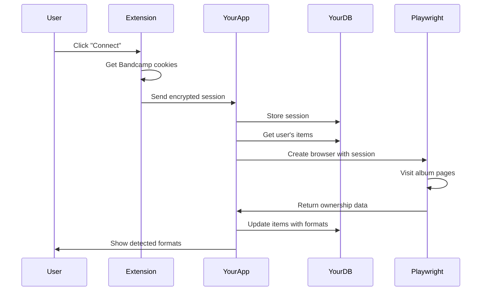

# Browser Extension Implementation Guide

## Architecture Overview

```
┌──────────────────┐     ┌──────────────────┐     ┌──────────────────┐
│  Chrome Browser  │────▶│  Your Extension  │────▶│   Your Web App   │
│  - User logged   │     │  - Captures      │     │  - Stores data   │
│    into Bandcamp │     │    session       │     │  - Runs detection│
│  - Normal use    │     │  - Sends to app  │     │  - Shows results │
└──────────────────┘     └──────────────────┘     └──────────────────┘
                                   │
                                   ▼
                         ┌──────────────────┐
                         │   Your Backend   │
                         │  - PostgreSQL    │
                         │  - Playwright    │
                         │  - Detection     │
                         └──────────────────┘
```

## How Data Storage Works

### YES - You Store Everything in Your App Database

The extension is just a **session capture tool**. All data lives in your app:

```sql
-- Your app database (PostgreSQL/Supabase)

-- Extension just provides session
CREATE TABLE user_sessions (
  id UUID PRIMARY KEY,
  user_id UUID REFERENCES auth.users(id),
  
  -- From extension
  session_token TEXT, -- Encrypted Bandcamp session
  cookies_data JSONB, -- Encrypted cookie jar
  captured_at TIMESTAMP,
  captured_from_ip INET,
  
  -- Session health
  is_valid BOOLEAN DEFAULT true,
  last_used TIMESTAMP,
  expires_at TIMESTAMP,
  
  created_at TIMESTAMP DEFAULT NOW()
);

-- All Bandcamp data stored in YOUR app
CREATE TABLE bandcamp_items (
  id UUID PRIMARY KEY,
  user_id UUID REFERENCES auth.users(id),
  
  -- Scraped data
  bandcamp_id VARCHAR(100),
  title TEXT,
  artist TEXT,
  album_url TEXT,
  
  -- Detection results (using session from extension)
  format VARCHAR(20),
  is_physical BOOLEAN,
  ownership_text TEXT,
  detected_at TIMESTAMP,
  
  -- This is YOUR data, not the extension's
  created_at TIMESTAMP DEFAULT NOW()
);
```

## Extension Structure

### Manifest V3 (Chrome)
```json
{
  "manifest_version": 3,
  "name": "BC→DC Sync Connector",
  "version": "1.0.0",
  "description": "Securely connect your Bandcamp account to BC→DC Sync",
  
  "permissions": [
    "cookies",
    "storage",
    "tabs"
  ],
  
  "host_permissions": [
    "https://*.bandcamp.com/*",
    "https://app.bcdc-sync.com/*"
  ],
  
  "background": {
    "service_worker": "background.js"
  },
  
  "content_scripts": [
    {
      "matches": ["https://*.bandcamp.com/*"],
      "js": ["content.js"]
    }
  ],
  
  "action": {
    "default_popup": "popup.html",
    "default_icon": {
      "16": "icon16.png",
      "48": "icon48.png",
      "128": "icon128.png"
    }
  }
}
```

### Extension Code

```javascript
// background.js - Service worker that captures sessions
chrome.runtime.onInstalled.addListener(() => {
  console.log('BC→DC Sync extension installed')
})

// Listen for messages from popup or content script
chrome.runtime.onMessage.addListener((request, sender, sendResponse) => {
  if (request.action === 'capture_session') {
    captureAndSendSession()
  }
})

async function captureAndSendSession() {
  // 1. Get Bandcamp cookies
  const cookies = await chrome.cookies.getAll({
    domain: '.bandcamp.com'
  })
  
  // 2. Get user token from extension storage
  const { userToken } = await chrome.storage.sync.get('userToken')
  
  if (!userToken) {
    // Not linked to app account yet
    chrome.runtime.openOptionsPage()
    return
  }
  
  // 3. Send to YOUR backend
  const response = await fetch('https://app.bcdc-sync.com/api/sessions/capture', {
    method: 'POST',
    headers: {
      'Authorization': `Bearer ${userToken}`,
      'Content-Type': 'application/json'
    },
    body: JSON.stringify({
      cookies: cookies,
      url: 'https://bandcamp.com',
      timestamp: Date.now(),
      extensionVersion: chrome.runtime.getManifest().version
    })
  })
  
  if (response.ok) {
    // 4. Session stored in YOUR database
    chrome.action.setBadgeText({ text: '✓' })
    chrome.action.setBadgeBackgroundColor({ color: '#00AA00' })
    
    // 5. Open your app to show success
    chrome.tabs.create({
      url: 'https://app.bcdc-sync.com/collection?session=captured'
    })
  }
}
```

### Popup UI (popup.html)
```html
<!DOCTYPE html>
<html>
<head>
  <style>
    body {
      width: 350px;
      padding: 15px;
      font-family: system-ui;
    }
    .status { 
      padding: 10px;
      border-radius: 5px;
      margin: 10px 0;
    }
    .connected { background: #d4f4dd; }
    .disconnected { background: #fdd4d4; }
    button {
      width: 100%;
      padding: 10px;
      background: #5e72e4;
      color: white;
      border: none;
      border-radius: 5px;
      cursor: pointer;
    }
  </style>
</head>
<body>
  <h3>BC→DC Sync Connector</h3>
  
  <div id="status" class="status">
    Checking connection...
  </div>
  
  <button id="connect">Connect Bandcamp Account</button>
  
  <script src="popup.js"></script>
</body>
</html>
```

```javascript
// popup.js
document.addEventListener('DOMContentLoaded', async () => {
  const statusDiv = document.getElementById('status')
  const connectBtn = document.getElementById('connect')
  
  // Check if user is logged into YOUR app
  const { userToken } = await chrome.storage.sync.get('userToken')
  
  if (!userToken) {
    statusDiv.className = 'status disconnected'
    statusDiv.textContent = 'Please link your BC→DC account first'
    connectBtn.textContent = 'Link BC→DC Account'
    connectBtn.onclick = () => {
      chrome.tabs.create({
        url: 'https://app.bcdc-sync.com/extension/link'
      })
    }
    return
  }
  
  // Check Bandcamp login status
  const cookies = await chrome.cookies.getAll({
    domain: '.bandcamp.com'
  })
  
  const isLoggedIn = cookies.some(c => c.name === 'identity')
  
  if (isLoggedIn) {
    statusDiv.className = 'status connected'
    statusDiv.textContent = 'Connected to Bandcamp ✓'
    connectBtn.textContent = 'Sync Collection Now'
    connectBtn.onclick = captureAndSync
  } else {
    statusDiv.className = 'status disconnected'
    statusDiv.textContent = 'Please log into Bandcamp first'
    connectBtn.textContent = 'Open Bandcamp Login'
    connectBtn.onclick = () => {
      chrome.tabs.create({
        url: 'https://bandcamp.com/login'
      })
    }
  }
})

async function captureAndSync() {
  // Send session to your backend
  chrome.runtime.sendMessage({ action: 'capture_session' })
}
```

## Your Web App Integration

### Linking Extension to User Account

```typescript
// app/extension/link/page.tsx
export default function ExtensionLinkPage() {
  const { user } = useAuth()
  const [linkCode, setLinkCode] = useState('')
  
  useEffect(() => {
    // Generate unique link code
    const code = generateLinkCode(user.id)
    setLinkCode(code)
    
    // Store in database temporarily
    saveLinkCode(user.id, code)
  }, [user])
  
  return (
    <div>
      <h1>Link Browser Extension</h1>
      
      <div className="steps">
        <div className="step">
          <h3>Step 1: Install Extension</h3>
          <a href="https://chrome.google.com/webstore/detail/bcdc-sync/xxxxx">
            Install from Chrome Store
          </a>
        </div>
        
        <div className="step">
          <h3>Step 2: Enter This Code in Extension</h3>
          <div className="code-display">
            {linkCode}
          </div>
          <button onClick={() => copyToClipboard(linkCode)}>
            Copy Code
          </button>
        </div>
        
        <div className="step">
          <h3>Step 3: Click Connect</h3>
          <p>The extension will capture your Bandcamp session</p>
        </div>
      </div>
      
      {/* Listen for successful connection */}
      <ConnectionListener userId={user.id} />
    </div>
  )
}
```

### Receiving Session from Extension

```typescript
// app/api/sessions/capture/route.ts
export async function POST(request: Request) {
  const token = request.headers.get('Authorization')?.replace('Bearer ', '')
  
  // Verify token from extension
  const user = await verifyExtensionToken(token)
  if (!user) {
    return new Response('Unauthorized', { status: 401 })
  }
  
  const { cookies, timestamp } = await request.json()
  
  // Encrypt and store session in YOUR database
  const encryptedSession = await encryptCookies(cookies, user.id)
  
  await db.insert(user_sessions).values({
    user_id: user.id,
    session_token: encryptedSession.token,
    cookies_data: encryptedSession.data,
    captured_at: new Date(timestamp),
    captured_from_ip: request.headers.get('X-Forwarded-For'),
    expires_at: calculateExpiry(cookies),
  })
  
  // Now YOU have the session and can run detection
  await triggerFormatDetection(user.id)
  
  return new Response('Session captured successfully', { status: 200 })
}
```

### Using the Session for Detection

```typescript
// lib/detection/detector.ts
export async function detectFormatsWithSession(userId: string) {
  // 1. Get session from YOUR database
  const session = await db.query.user_sessions.findFirst({
    where: eq(user_sessions.user_id, userId),
    orderBy: desc(user_sessions.captured_at)
  })
  
  if (!session || !session.is_valid) {
    throw new Error('No valid session')
  }
  
  // 2. Decrypt cookies
  const cookies = await decryptCookies(session.cookies_data, userId)
  
  // 3. Use with Playwright on YOUR backend
  const browser = await playwright.chromium.launch()
  const context = await browser.newContext()
  
  // Load cookies into browser context
  await context.addCookies(cookies)
  
  // 4. Get user's Bandcamp items from YOUR database
  const items = await db.query.bandcamp_items.findMany({
    where: and(
      eq(bandcamp_items.user_id, userId),
      eq(bandcamp_items.format, 'unknown')
    )
  })
  
  // 5. Detect formats
  for (const item of items) {
    const page = await context.newPage()
    await page.goto(item.album_url)
    
    // Look for ownership text
    const ownershipText = await page.$eval(
      '.you-own-this-txt',
      el => el?.textContent
    ).catch(() => null)
    
    // 6. Store results in YOUR database
    await db.update(bandcamp_items)
      .set({
        format: parseFormat(ownershipText),
        is_physical: isPhysical(ownershipText),
        ownership_text: ownershipText,
        detected_at: new Date()
      })
      .where(eq(bandcamp_items.id, item.id))
    
    await page.close()
    await delay(2000) // Rate limiting
  }
  
  await browser.close()
}
```

## Data Flow Summary



## What Lives Where

### In the Extension (minimal):
- Link to your app account (token)
- UI for capturing session
- Nothing else - it's just a bridge

### In Your App Database (everything):
- User accounts
- Bandcamp sessions (encrypted)
- Collection items
- Format detection results
- Sync history
- User preferences
- Everything that matters

### Key Points:
1. **Extension never stores Bandcamp data** - just captures session
2. **All data lives in YOUR database** - you control everything
3. **Extension is disposable** - if Chrome blocks it, data is safe
4. **Users own their data** - it's in your app, not the extension

## Security Considerations

### Encryption Flow
```javascript
// Your backend - storing sessions
async function encryptSession(cookies, userId) {
  // User-specific encryption key
  const userKey = await deriveKeyFromUserId(userId)
  
  // Encrypt cookies
  const iv = crypto.randomBytes(16)
  const cipher = crypto.createCipheriv('aes-256-gcm', userKey, iv)
  
  const encrypted = Buffer.concat([
    cipher.update(JSON.stringify(cookies)),
    cipher.final()
  ])
  
  const authTag = cipher.getAuthTag()
  
  return {
    data: encrypted.toString('base64'),
    iv: iv.toString('base64'),
    authTag: authTag.toString('base64')
  }
}

// Only YOUR backend can decrypt
async function decryptSession(encryptedData, userId) {
  const userKey = await deriveKeyFromUserId(userId)
  
  const decipher = crypto.createDecipheriv(
    'aes-256-gcm',
    userKey,
    Buffer.from(encryptedData.iv, 'base64')
  )
  
  decipher.setAuthTag(Buffer.from(encryptedData.authTag, 'base64'))
  
  const decrypted = Buffer.concat([
    decipher.update(Buffer.from(encryptedData.data, 'base64')),
    decipher.final()
  ])
  
  return JSON.parse(decrypted.toString())
}
```

## Development Timeline

### Week 1: Extension Development
- Day 1-2: Basic extension structure
- Day 3-4: Session capture logic
- Day 5: Your app integration

### Week 2: Backend Integration
- Day 1-2: Session storage API
- Day 3-4: Detection worker setup
- Day 5: Testing with real users

### Publishing to Chrome Store
```bash
# 1. Create developer account ($5 one-time)
https://chrome.google.com/webstore/devconsole

# 2. Prepare assets
- 128x128 icon
- 1280x800 screenshot
- 440x280 promotional tile

# 3. Write description
"Securely connect your Bandcamp account to BC→DC Sync 
for automatic format detection. Your session is encrypted 
and only used for detecting physical vs digital items."

# 4. Submit for review (2-3 days)
```

## User Experience

### For Users:
1. Install extension from Chrome Store (2 clicks)
2. Click extension icon
3. Link to BC→DC account (one time)
4. Click "Connect Bandcamp" 
5. Done - everything else happens in your app

### What Users See:
- Extension icon shows connection status
- Your app shows detection progress
- All data management in your app
- Extension is just a "key" to unlock features

## The Bottom Line

**YES** - Everything is stored in YOUR app:
- User data ✓
- Collection items ✓  
- Detection results ✓
- Sync history ✓

The extension is just a **secure bridge** that:
- Captures the session (30 seconds)
- Sends to your backend (encrypted)
- Never stores anything permanently
- Can be replaced/removed without data loss

This is the same model as:
- 1Password browser extension (captures passwords, stores in app)
- Grammarly (captures text, processes in cloud)
- Honey (captures shopping, saves in account)

Users understand and trust this model.